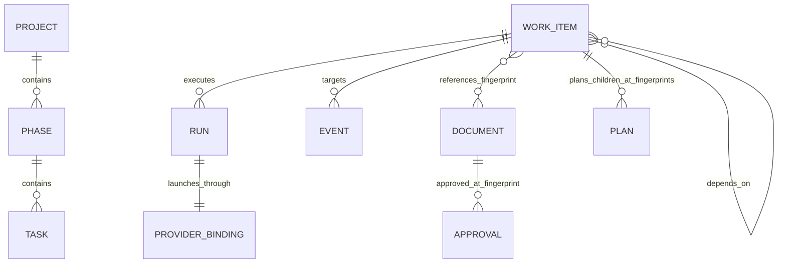

# Delivery workflow: data model and relationships

Status: extraction of the repository's current workflow contracts and implementation,
not approval of a new CLI architecture or a migration of existing projects.

Extracted: 2026-11-05 (UTC). Source revision: `bebd142`.

This document consolidates the phase/task format for use when designing a CLI. It
separates the intended domain contract from storage adapters and known implementation
gaps. The grouped model is the current direction; older `workflowKind`,
`workflowOrder`, `workflowRequirements`, and `workflowDocuments` examples are not a
second supported domain schema.

## 1. Model at a glance



`WORK_ITEM` is the shared abstraction for project, phase, and task. `DOCUMENT`
means a PRD or design record; both use native mtn records but are outside the
progress hierarchy. `APPROVAL` and `PLAN` are event kinds, not separate native
record kinds. This diagram describes domain relationships, not proposed tables.

### Record kinds

| Kind | Canonical collection-relative ref pattern | Purpose |
| --- | --- | --- |
| `project` | `projects/<slug>.md` | Accepted delivery scope and requirement universe |
| `prd` | `prds/<slug>.md` | What/why, stable requirement IDs, observable acceptance criteria |
| `design` | `designs/<slug>.md` | Optional technical design/RFC, interfaces, risks, alternatives |
| `phase` | `phases/<project>-<NN>-<slug>.md` | Independently verifiable milestone |
| `task` | `tasks/<project>-<NN>-<NN>-<slug>.md` | Ownership-bounded, independently reviewable implementation unit |

A task owns its complete RED/GREEN/refactor cycle. Tests and implementation are
not separately completable tasks. A phase is not an arbitrary agent-sized chunk.

## 2. Identity and references

| Identifier | Meaning and lifetime |
| --- | --- |
| `identity.uuid` | Immutable record identity; intended to be the native record UUID |
| `identity.projectID`, `phaseID`, `taskID` | Stable type-specific business ID; unchanged across retries |
| `recordRef` | Exact collection-relative target, e.g. `tasks/demo-01-01-parser.md` |
| `runID` | One execution, not a work-item ID; replacement execution gets a new ID |
| `eventID` | Unique immutable event identity; also the publication retry key |
| `specHash` | SHA-256 fingerprint of a semantic specification, not an execution ID |
| `REQ-001` | Stable requirement ID within the selected project's requirements |
| Native `revision` | Mutable mtn record revision; **not** the semantic fingerprint |

Display names, titles, order numbers, and launcher labels are not identities or
resource selectors. Resolve numeric selections within their parent; reject ambiguity.
Refs do not start with `.tasks/`, are not absolute paths, and are not titles.

Do not renumber surviving requirements or completed work. A renamed display name
must not change the UUID, stable work-item ID, or execution identity.

## 3. Grouped work-item model

The following is a domain example, not literal native frontmatter or a complete
create request. Native presentation and relationships are adapted as described below.

```yaml
ref: tasks/demo-01-01-parser.md
specHash: sha256:...
identity:
  uuid: 00000000-0000-0000-0000-000000000001
  kind: task
  taskID: demo-01-01-parser
presentation:
  displayName: Implement parser
  description: |
    ## Deliverable
    Parse literal commands and reject invalid input.
    ## Acceptance criteria
    1. Reject empty input.
    2. Preserve quoted text.
structure:
  parentRef: phases/demo-01-parser.md
  order: 1
scope:
  requirements: [REQ-001]
  documents:
    - ref: prds/demo.md
      hash: sha256:...
  dependencies: []
lifecycle:
  state: planned
  sourceEventID: null
  changedAt: 2026-11-05T00:00:00Z
execution:
  current:
    dispatchEventID: null
    runIDs: []
    runs: []
implementation:
  language: go
  gates:
    - ID: unit-tests
      command: task test
      required: true
  ownership:
    paths: [internal/parser]
    sharedPaths: []
    resources: []
    interfaces: []
```

### Field contract

| Group | Fields | Rules |
| --- | --- | --- |
| `identity` | `uuid`, `kind`, type-specific stable ID | Project/phase/task require their matching ID; documents currently have no specified business-ID field |
| `presentation` | `displayName`, `description` | Description is semantic Markdown; display name is administrative |
| `structure` | `parentRef`, `order` | Project has no parent; phase has one project parent; task has one phase parent |
| `scope` | `requirements`, `documents`, `dependencies` | References requirements, exact document fingerprints, and explicit prerequisites |
| `lifecycle` | `state`, `sourceEventID`, `changedAt` | Materialized current state; evidence is the reconciliation authority; timestamps use UTC |
| `execution` | `current`, `coordinator` | Current execution pointers/projections, not durable work-item identity |
| `implementation` | `language`, `gates`, `ownership` | Required task execution scope; optional for projects/phases |

The normalized facade additionally exposes `lifecycle.nativeStatus`. This is the
configured native status, not the richer workflow state.

Phase/task `order` is a positive integer, unique among siblings of the same kind.
Order is only a scheduling preference, never an implicit prerequisite. Current
metadata validation requires nonempty requirement and document lists for phases/tasks.

### Task implementation scope

Supported languages: `go`, `node`, `zig`, `lua`, `nix`, `docs`.

- `gates`: deterministic deliverable checks, using `{ID, command, required}`.
  Review verdicts belong in evidence, not this list.
- `ownership.paths`: nonempty list of owned repository-relative files/directories.
- `ownership.sharedPaths`: additional expected edits to shared files. These remain
  **exclusive reservations**, not permission for concurrent edits.
- `ownership.resources`: exclusive build/test resources such as fixed ports/databases.
- `ownership.interfaces`: contracts this task will change. Consuming an already
  approved immutable interface does not require reserving it exclusively.

All four ownership arrays must exist for task validation. Paths are literal,
normalized, repository-relative; reject globs, traversal, absolute paths, and
symlink escapes. A directory includes descendants; `.` owns the entire repository.
Conflict comparison conservatively folds case. Matching resources/interfaces also
conflict. Reservations persist through review and integration even when no builder
process is running.

Descriptions capture deliverable, allowed edits, interface inputs/outputs,
prerequisites, acceptance criteria, TDD scenarios, verification/integration commands,
constraints, and final-phase gate responsibility. Metadata alone is not the full spec.

## 4. Relationships and invariants

### Hierarchy is not dependency

- A project contains zero or more phases; each phase has exactly one project parent.
- A phase contains zero or more tasks; each task has exactly one phase parent.
- Projects, PRDs, and designs have no parents. Documents do not inflate progress.
- Multiple parents are invalid, even if native mtn permits them.
- Native membership operations are authoritative for hierarchy; derive `parentRef`
  from resolved native parents, not Markdown links or a custom parent field.
- Dependencies point from the dependent to its prerequisite. The normalized shape is
  `{ref, relation: "finish-to-start"}`; native default is `FINISHTOSTART`.
- Prefer task-level edges for specific producer/consumer deliverables. Phase-level
  edges represent genuine whole-milestone barriers.
- A task readiness query does not inherit its parent phase's prerequisites. Check both.
- Validate unknown targets and cycles before scheduling; numbering creates no edges.

Example: task B depends on task A's interface artifact. Add B → A, not an artificial
chain through all earlier tasks. Add phase 2 → phase 1 only if the whole milestone
is truly required before any phase-2 task can start.

### Requirement and document traceability

A PRD or design-only entry point defines stable requirement IDs and observable
acceptance criteria. A design-only project does not require a duplicate PRD. If no
requirements document exists, capture and approve minimal requirements first.

Phases/tasks reference requirements through `scope.requirements` and governing
specifications through `scope.documents[{ref,hash}]`. A project plan maps accepted
requirements to phases; a phase plan maps criteria/requirements to tasks. Every
accepted requirement needs coverage. Complementary contributions are allowed, but
must not double-count completion. Deferral needs explicit approval.

### Fingerprint-bound plans

A `plan` event lives on the parent being planned and includes:

```yaml
schemaVersion: 1
eventID: demo/plan/1
kind: plan
recordRef: projects/demo.md
specHash: sha256:...
attempt: 1
decision: approved
approvedBy: actual-approving-authority
decisionEvidence: exact-source-of-approval
records:
  - ref: phases/demo-01-parser.md
    specHash: sha256:...
documents:
  - ref: prds/demo.md
    hash: sha256:...
coverage:
  REQ-001: [phases/demo-01-parser.md]
```

This is a shape example, not evidence that approval occurred. Plans also record
explicit dependencies, relevant interfaces, deferred scope, and the actual approval
policy/authority. Simple work may omit a design with approved rationale; material
interface/security/persistence changes require a design.

The guard accepts coverage as an object map or as
`[{requirement: "REQ-001", records: ["phases/..."]}]`. Manifest entries may carry
additional planning metadata. Current direct children and their fingerprints must
match the approved manifest exactly; governing documents must be currently approved.
Missing coverage or stale fingerprints block dispatch.

## 5. Runs, launcher bindings, and coordinator ownership

A run is separate from its stable work item:

```yaml
runID: demo-01-01-reviewer-run-1
role: reviewer
state: active
workItemRef: tasks/demo-01-01-parser.md
coordinator:
  runID: demo-phase-01-coordinator-run-1
provider:
  name: rex
  displayName: p01-t01-reviewer
  resources:
    session: session:...
    window: window:...
    block: block:...
```

Roles currently used: `coordinator`, `planner`, `builder`, `reviewer`. No complete
generic run-state enum is specified; `active` is used in current projections.

`provider` is the generic launcher boundary. Its resource map is provider-owned;
exact IDs are authoritative. Domain records must not depend on top-level fields
such as `rexWindowID`, `piSessionID`, or `tmuxPaneID`.

Current work-item execution projection:

- `execution.current.dispatchEventID`: current reservation.
- `execution.current.runIDs`: compact active-run index.
- `execution.current.runs`: normalized active run objects with generic bindings.
- `execution.coordinator`: `{runID,state,phaseRef}` and optional provider binding.

At most one coordinator owns a selected phase at a time. One project coordinator
serializes collection mutations, scheduling, and target integration, potentially
across several phases. Workers are read-only collection clients. Phase ownership
is not a permanent machine identity. Coordinator and workers are host-sticky within
an execution; collection/evidence portability does not authorize automatic takeover.

The current Rex/Pi transport still uses provider-specific runtime event fields. It
requires Pi session ID = canonical `runID`, exact host endpoint/hostID/instanceID,
model/thinking, skill, worktree, role, stage, and transport location. A reserved
runtime precedes launcher creation; a launched runtime adds exact Rex resource IDs
before Pi startup. Workers link phase/coordinator and builder/reviewer dispatch IDs;
coordinators require `handoff:true`. Runtime locators are not proof of process
liveness, review approval, completion, or permission to release a reservation.

## 6. Event model

Events are JSON objects serialized inside native mtn note `content`, published only
by the coordinator. Common envelope:

```yaml
schemaVersion: 1
eventID: demo-01-01/build/1
kind: build
recordRef: tasks/demo-01-01-parser.md
specHash: sha256:...
attempt: 1
```

Every event requires these fields, including a positive integer `attempt`.
`eventID`/retry key identifies one immutable payload. Identical retries are allowed;
changed content, code, or verdict needs a new identity. IDs must be unambiguous
within the evidence stream. Attribution is caller-supplied, not authenticated.
Malformed or unsupported evidence fails closed.

### Event kinds and links

| Kind | Payload and relationship |
| --- | --- |
| `approval` | `decision` approved/rejected, `approvedBy`, `decisionEvidence`; exact document fingerprint and actual authority |
| `plan` | Approved parent manifest: child refs/hashes, documents, coverage, dependencies, actual authority |
| `dispatch` | `runID`, `baseCommit`, `branch`, `targetBranch`, absolute `worktree`; reserves allowed scope/commands before launch |
| `runtime` | Execution locator, reserved/launched stage, provider/host/transport metadata; no approval or completion effect |
| `build` | `dispatchEventID`, `head`, `tree`, outcome ready-for-review/blocked, validation, files/tests, RED/GREEN evidence, limitations |
| `review` | `buildEventID`, identical `head`/`tree`/attempt, reviewer specialty, verdict, findings, criterion evidence, independent validation |
| `integration` | Build and exact current review IDs, reviewed head/tree, target branch/base, validation, outcome; passed → integrated commit/tree; failed → preserved candidate commit/tree |
| `completion` | `integrationEventID` naming the successful accepted integration |
| `milestone` | Nonempty completed child records, target commit/tree/branch, coverage, passing combined-target validation |
| `blocker` | Concrete reason, affected refs, required decision/recovery |
| `resume` | Exact `blockerEventID`, resolution evidence and authorization |
| `release` | `dispatchEventID`, outcome stopped/finished, confirmed process/host evidence |
| `summary` | Compact completed-delivery proof; detailed fields below |
| `historical` | Original content, provenance, `gateEligible:false`; legacy import additionally names exact native note intents and actual authority |
| `baseline` | Explicit historical exemption: actual authority, target commit/tree/branch, passing validation, `reviewEquivalent:false` |
| `recovery` | Narrow authorization to quarantine one malformed document approval, not replacement approval itself |

Review specialties are `combined`, `code`, `comment`, `architecture`, `test`.
Go/Node/Lua/Nix/docs require `combined`; Zig requires the latter four independently.
`APPROVED` requires zero `changes_required` and passing independent validation.
`CHANGES_NEEDED` requires blocking findings. Findings identify stable ID, file:line,
rule, evidence, impact, required outcome, and specialties needing recheck.
`NON_BLOCKING_SUGGESTIONS` do not gate delivery.

Reviews bind to one exact build/spec/head/tree/attempt. New builds invalidate prior
reviews. The latest verdict for each specialty governs that build; never combine
approvals across attempts.

Recovery authorization binds an earlier malformed approval by event ID, spec hash,
native intent hash, and content digest. It names collection root, approving authority,
decision evidence, and a new replacement approval ID. Reassessment explicitly links
`supersedesRecoveryEventID`. Original bytes are preserved as non-gating history; a
later valid replacement approval is still required. See the source adapter for
exact chain/relocation validation.

## 7. Lifecycle, readiness, and completion

Workflow state is derived from current-spec evidence, not timestamps or English
native status labels. Blockers survive specification revisions until individually
resolved. Native completion alone does not prove delivered work.

| State | Meaning / next action |
| --- | --- |
| `planned` | No dispatch; schedule only after all approval/readiness guards pass |
| `building` | Reserved dispatch without build; reconcile before any replacement |
| `interrupted` | Confirmed stopped dispatch without build; inspect and use new attempt |
| `reviewing` | Passing current build missing required approvals |
| `fixing` | Current review has blocking findings; create a new fix attempt |
| `awaiting-integration` | All required current-build reviews approve |
| `integrated` | Matching successful integration; verify history and publish completion |
| `complete` | Completion links integration, or verified compact summary proves delivery |
| `blocked` | Unresolved explicit or implicit blocked-build blocker |
| `retryable` | All blocked-build blockers explicitly resolved; confirm old writer stopped |
| `baseline` | Approved historical exemption with no newer delivery work; verify native status/history |

Historical evidence does not itself produce approval or delivery state. A state
reducer is not sufficient proof: Git objects, target ancestry, process stoppage,
current approvals, native statuses, and ownership must also be checked.

Task eligibility requires all of: correct kind/membership/language, incomplete and
allowed native status, current document/plan approval, valid coverage/metadata,
verified task prerequisites **and phase prerequisites**, no blockers/live conflicting
writer, and safe ownership/resource capacity. `agentEligible:null` is neither approval
nor a claim. Readiness is a snapshot, not a lease.

Select deterministically by phase order, task order, then ref among eligible tasks.
Use separate builder/reviewer/heavy-gate/integration limits sharing one CPU/memory/disk
budget. Scope reservations are distinct from live worker counts. No process launch
or cross-process admission enforcement follows merely from computing a safe batch.

### Integration boundary

Review approval authorizes integration, not completion. The coordinator applies an
approved result to a speculative candidate from the current target base. Semantic
conflict resolutions/adaptations require new review. Run combined-target checks;
only fast-forward the target if it still matches that base. Failure preserves the
candidate without changing target history. Verify integrated-commit ancestry before
completion. Workers never merge, push, or deploy by default.

A phase completes only after its required children are integrated/completed,
coverage is satisfied, and final combined-target gates pass. Project completion
similarly requires all planned phases and project-wide acceptance. Empty-parent
progress percentages are not delivery proof. Reopening work requires reassessing
completed ancestors/dependents and affected approvals.

### Completion summary and retention

A summary has the common envelope plus:

- `summaryVersion:1`, `status:"complete"`.
- `acceptedScope`, `requirements`, nonempty `approvalSummary`.
- `targetCommit`, `targetTree`, `targetBranch`.
- `verification`: nonempty actual passing `{command,result:"pass"}` entries.
- `files`: exact artifact/source refs; `limitations`: explicit remaining limitations.
- For phases, exact completed child refs (`records` in current completion checks).

After native completion and confirmed runtime release, compaction replaces the
record's evidence suffix with one coordinator-authored summary. It preserves
identity, specification, relationships, referenced artifacts, and semantic hash.
There is **no guaranteed permanent event archive**. Active records retain only
coordination/recovery state and small pointers, not prompts, logs, or full prior
attempts. A future CLI must not assume the entire historical event stream survives.

## 8. Semantic fingerprint

Current canonical input for projects/phases/tasks:

```text
ref, kind, description, language, requirements, documents,
ownership, gates, parentRef, dependencies
```

For PRDs/designs: `ref`, `kind`, `description` only.

Ownership paths are filesystem-normalized. Encode the current canonical projection
with `jq -S -c`, then SHA-256 its bytes using the existing facade. Object keys are
sorted; this is not a promise that all arrays are semantically reordered.

Excluded: display name/title, structural order, UUID/stable-ID fields in the
current hash implementation, evidence, timestamps, execution bindings, native
status, completion dates. Do not confuse native revision with this hash or rewrite
content merely to retain approval. Semantic changes require impact assessment and
appropriate reapproval; administrative title/order changes do not.

## 9. Persistence and CLI boundary

Current persistence is one repository-local `.tasks/` mtn collection, not parallel
phase/task/status YAML indexes. No managed-record hand edits or implicit migrations.

| Domain concern | Current adapter/storage |
| --- | --- |
| UUID / presentation | Grouped identity plus native `id`, title/body adapters |
| Grouped workflow metadata | Schema-permitted identity/structure/scope/lifecycle/execution/implementation fields |
| Parent / dependencies | Native membership/dependency graph, normalized into grouped output |
| Evidence | Versioned JSON inside native note content, matching category and retry key |
| Current status | Evidence-derived lifecycle plus diagnosed native completed/incomplete policy |
| Detailed worker output | Referenced artifact/transport files, not a second workflow database |

Native APIs: `agent show`, `hierarchy`, `dependencies`, `ready`, `validate`, `create`,
`describe`, typed `patch`, `project-*`, `depends-*`, `note`, `status`, `complete`,
`reopen`. Agent replies use `{version:1,ok,result}`; `list --json` is a bare array.
Check exit status and envelope. Create and membership are separate writes; recover
partial success idempotently. Native mtn does not provide multi-record transactions,
exclusive task claims, scheduling, Git integration, or authenticated approval.

The existing `mtn-workflow` facade already supplies status/task/snapshot, fingerprint,
ready/ready-phase, language routing, paths, budgets/disk/cleanup planning, create,
publish, complete, and compact. These are existing capability boundaries, not a
mandated command design for the future CLI. Its coordinator environment marker is
a role guard, not a security boundary or a lock. The kernel-lock proposal is not
approved/enabled.

## 10. Known discrepancies and unresolved contract details

These are extraction findings, not proposed resolutions or newly accepted requirements.

1. **Legacy planning prose:** `to-phases`/`write-phase` still name flat `workflow*`
   fields, while the protocol, data model, create examples, and adapter use grouped
   fields. Use grouped fields as the current contract; reconcile skill prose before
   using it as an implementation specification.
2. **UUID semantics:** the domain calls UUID the immutable native UUID, but the create
   wrapper generates `identity.uuid` itself and falls back to a millisecond UTC date
   ID without `uuidgen`. The adapter accepts any nonempty string and prefers it over
   native `id`. True native-ID equality and UUID syntax are not currently guaranteed.
3. **Identity validation:** stable ID syntax, global uniqueness scope, rename/ref-move
   behavior, and immutability enforcement are not fully specified/enforced by the
   inspected guards. Do not infer these from example slugs.
4. **Provider abstraction:** generic bindings coexist with Rex/Pi-specific runtime
   validation. A provider-neutral runtime event contract and complete run-state enum
   are not yet specified. The data model says a run ID may disappear after completion;
   interpret this as removing live pointers, not permission to reuse its identity.
5. **Dependency authority:** the adapter currently prefers stored
   `scope.dependencies` over native `blockedBy` when present. The protocol calls for
   native graph operations. Disagreement handling between the two needs clarification;
   do not introduce independent dual-write truth.
6. **Guard versus policy:** minimum JSON validators do not enforce every prose rule
   (gate shape, all detailed findings/approval/coverage fields, process facts, and Git
   facts). Tests/source and policy must both inform a typed schema, not the validator
   alone. The reducer also prioritizes a summary before unresolved blockers, whereas
   the policy requires blockers to be resolved before valid completion/compaction.
7. **Release linkage:** runtime projections currently look for release events naming
   a runtime event ID, while the general release contract names a dispatch event ID.
   Normalize this distinction explicitly before reproducing projection logic.
8. **Plan granularity:** policy describes criterion-to-task coverage, but the generic
   guard validates accepted requirement IDs. A separately typed criterion-ID model,
   deferral encoding, and dependency manifest schema are not fully defined here.
9. **Versioning and storage:** evidence uses v1; no separate grouped-record schema
   version or approved replacement storage/API is defined. This extraction does not
   authorize migration, a language choice, a database choice, or a permanent audit log.

## 11. Source map

Paths below are repository-relative; linked contracts remain authoritative for workflow policy.

- [Grouped domain model](../modules/home/llm/skills/mtn-tasks/references/data-model.md)
- [Delivery protocol and event contract](../modules/home/llm/skills/mtn-tasks/references/protocol.md)
- [Native command/storage adapter contract](../modules/home/llm/skills/mtn-tasks/references/commands.md)
- [Execution and integration](../modules/home/llm/skills/mtn-tasks/references/execution.md)
- [Facade capabilities](../modules/home/llm/skills/mtn-tasks/references/facade.md)
- [Resource policy](../modules/home/llm/skills/mtn-tasks/references/resources.md)
- [Migration policy](../modules/home/llm/skills/mtn-tasks/references/migration.md)
- [Rex/Pi transport details](../modules/home/llm/skills/mtn-tasks/references/rex.md)
- [Phase planning](../modules/home/llm/skills/to-phases/SKILL.md)
- [Single-phase capture](../modules/home/llm/skills/write-phase/SKILL.md)
- [Canonical projection and hashing](../modules/home/llm/skills/mtn-tasks/scripts/facade.jq)
- [Evidence, plan, state, ownership, readiness guards](../modules/home/llm/skills/mtn-tasks/scripts/workflow.jq)
- [Current Bash facade](../modules/home/scripts/mtn-workflow)

For conformance examples, see `modules/home/llm/skills/mtn-tasks/tests/` and
`modules/home/scripts/tests/mtn-workflow*_test.sh`. This documentation-only extraction
does not claim that those suites were run or that every policy is enforced in code.
