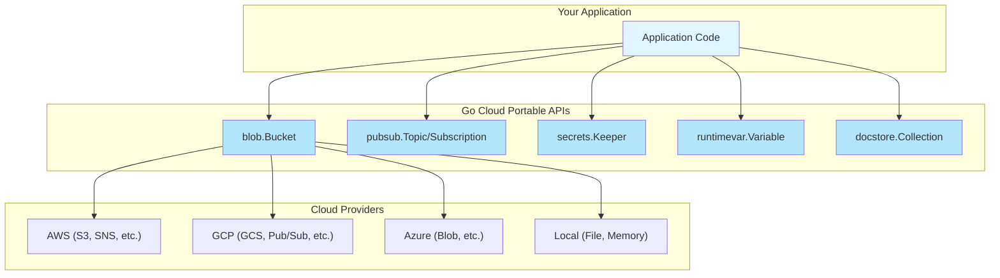

# Go Cloud SDK Patterns

The Go Cloud Development Kit (https://gocloud.dev/) provides portable Cloud APIs. Follow these patterns to build reusable, cloud-agnostic components.

## Core Concepts

### Portable Types

Go Cloud provides portable types that work across cloud providers:



### URL-Based Construction

Open resources using URLs for configuration-driven initialization:

```go
import (
    "context"
    "gocloud.dev/blob"
    _ "gocloud.dev/blob/s3blob"    // Register S3 driver
    _ "gocloud.dev/blob/gcsblob"   // Register GCS driver
    _ "gocloud.dev/blob/fileblob"  // Register file driver
)

func NewStorage(ctx context.Context, bucketURL string) (*blob.Bucket, error) {
    // URL determines provider:
    // "s3://my-bucket"       -> AWS S3
    // "gs://my-bucket"       -> Google Cloud Storage
    // "file:///tmp/bucket"   -> Local filesystem
    return blob.OpenBucket(ctx, bucketURL)
}
```

---

## Applying Go Cloud Patterns

Use the SDK's portable types and URL-based constructors directly where they fit.
Add an application-specific interface only when a consumer needs a smaller API or
a substitution point. Do not create separate interface, implementation, and service
packages just to wrap the SDK.

---

## Go Cloud Services Reference

| Service | Package | URL Schemes |
|---------|---------|-------------|
| Blob Storage | `gocloud.dev/blob` | `s3://`, `gs://`, `azblob://`, `file://` |
| Pub/Sub | `gocloud.dev/pubsub` | `awssns://`, `gcppubsub://`, `azuresb://`, `mem://` |
| Secrets | `gocloud.dev/secrets` | `awskms://`, `gcpkms://`, `azurekeyvault://` |
| Runtime Config | `gocloud.dev/runtimevar` | `awsparamstore://`, `gcpruntimeconfig://` |
| Document Store | `gocloud.dev/docstore` | `dynamodb://`, `firestore://`, `mongo://` |
| MySQL/PostgreSQL | `gocloud.dev/mysql`, `gocloud.dev/postgres` | Cloud SQL, RDS URLs |

---

## Design Principles

### 1. Choose Portable APIs

Keep provider selection configurable using the SDK's portable APIs. A wrapper is
not required when `blob.Bucket` or another SDK type already meets the need.

### 2. URL-Based Configuration

```go
// GOOD: URL-based, environment-configurable
bucket, _ := blob.OpenBucket(ctx, os.Getenv("BUCKET_URL"))

// BAD: Hard-coded provider
sess := session.Must(session.NewSession())
bucket := s3blob.OpenBucket(ctx, sess, "my-bucket", nil)
```

### 3. Local Development Support

Always support local alternatives for development:

```go
func getStorageURL() string {
    if url := os.Getenv("STORAGE_URL"); url != "" {
        return url
    }
    // Default to local filesystem for development
    return "file:///tmp/local-storage"
}
```

### 4. Graceful Cleanup

```go
type App struct {
    bucket *blob.Bucket
    topic  *pubsub.Topic
}

func (a *App) Close() error {
    var errs []error
    if err := a.bucket.Close(); err != nil {
        errs = append(errs, err)
    }
    if err := a.topic.Shutdown(context.Background()); err != nil {
        errs = append(errs, err)
    }
    return errors.Join(errs...)
}
```

---

## Testing with Go Cloud

### Use In-Memory Providers

Use the SDK's in-memory providers to exercise the behavior under test without
network access. Test real reads, writes, and error paths through the consumer's
public API. Register cleanup and use testify for assertions.

### Use File-Based for Integration Tests

```go
func TestDocumentService_Integration(t *testing.T) {
    if testing.Short() {
        t.Skip("skipping integration test")
    }

    dir := t.TempDir()
    bucket, _ := blob.OpenBucket(context.Background(), "file://"+dir)
    defer bucket.Close()

    // Run integration tests with real file I/O
}
```

---

## References

- Go Cloud Development Kit: https://gocloud.dev/
- Blob Storage: https://gocloud.dev/howto/blob/
- Pub/Sub: https://gocloud.dev/howto/pubsub/
- Secrets: https://gocloud.dev/howto/secrets/
- Portable Types Design: https://gocloud.dev/concepts/as/
